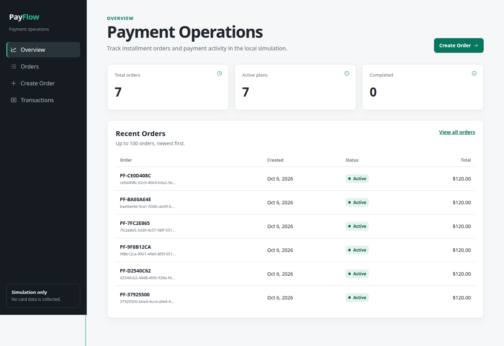
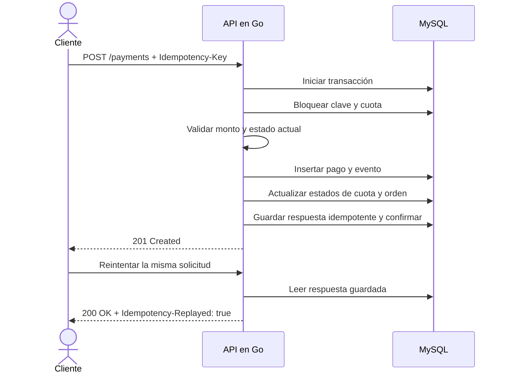
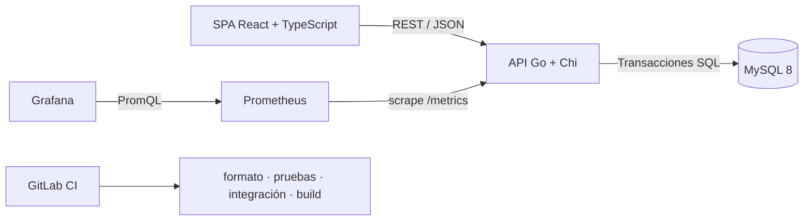
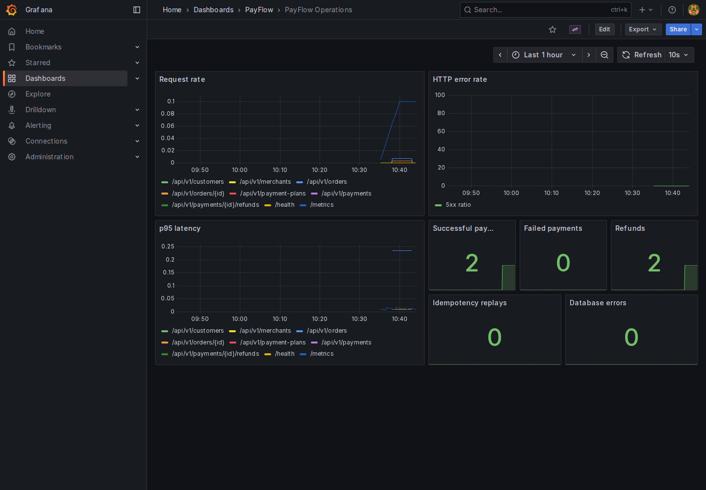

<div align="center">

# PayFlow

**Un entorno de pagos en cuotas construido alrededor de los fallos que realmente importan:**<br>
redondeo, reintentos, solicitudes duplicadas, reembolsos parciales y límites transaccionales.

[English](./README.md) · [**Español**](./README.es.md)


[](./LICENSE)

</div>



PayFlow es un proyecto de portafolio que construí para explorar una pregunta sencilla: ¿qué hace que un endpoint de pago se comporte como una operación financiera confiable?

La respuesta está principalmente en los casos límite. Un reintento no puede cobrar dos veces. Tres cuotas deben sumar exactamente el total original. Un reembolso parcial no puede superar el pago capturado. Si una escritura falla a mitad del proceso, la base de datos debe volver a su estado anterior. Este repositorio mantiene esas decisiones a la vista en lugar de esconderlas detrás del SDK de un proveedor de pagos.

> [!IMPORTANT]
> PayFlow utiliza pagos simulados y no almacena datos de tarjetas. Es un caso de estudio de ingeniería, no un procesador de pagos listo para producción.

<details>
<summary><strong>Contenido</strong></summary>

- [Qué se puede hacer](#qué-se-puede-hacer)
- [Ejecución local](#ejecución-local)
- [El recorrido de un pago](#el-recorrido-de-un-pago)
- [Arquitectura](#arquitectura)
- [Superficie de la API](#superficie-de-la-api)
- [Pruebas](#pruebas)
- [Observabilidad](#observabilidad)
- [Mapa del repositorio](#mapa-del-repositorio)
- [Notas de ingeniería](#notas-de-ingeniería)
- [Límites actuales](#límites-actuales)

</details>

## Qué se puede hacer

- Crear clientes, comercios, órdenes y planes de 2 a 4 cuotas.
- Pagar una cuota o ejecutar a propósito el flujo de pago rechazado.
- Reintentar una solicitud con la misma clave de idempotencia sin crear un segundo pago.
- Emitir reembolsos parciales y completos, evitando reembolsar más de lo cobrado.
- Revisar el historial de un cliente y el estado de cada cuota.
- Observar en Grafana métricas de solicitudes, latencia, pagos, reembolsos, reintentos y errores de base de datos.

La interfaz tiene un enfoque operativo, no de checkout: los IDs, estados, montos y controles de fallo permanecen visibles porque son útiles al seguir el recorrido de una operación financiera.

## Ejecución local

Se necesita Docker con el plugin de Compose y Make.

```bash
git clone https://github.com/Toudopooks/payflow.git
cd payflow
cp .env.example .env
docker compose up --build
```

Cuando terminen los health checks, se puede abrir:

| Servicio        | URL                            | Uso                                       |
| --------------- | ------------------------------ | ----------------------------------------- |
| PayFlow         | <http://localhost:3000>        | Crear una orden y ejecutar su primer pago |
| Salud de la API | <http://localhost:8080/health> | Incluye el estado de MySQL                |
| Prometheus      | <http://localhost:9090>        | Targets y consultas sin procesar          |
| Grafana         | <http://localhost:3001>        | `admin` / `payflow-local` para uso local  |

Para agregar datos sintéticos opcionales:

```bash
make seed
```

El stack se detiene con `docker compose down`. Se debe agregar `-v` únicamente si también se quiere eliminar el volumen local de MySQL.

## El recorrido de un pago

La parte interesante de PayFlow no es solamente el `POST`, sino todo lo que debe ocurrir como una única operación.



Si la validación o la persistencia falla, la transacción se revierte. Reutilizar la clave con un cuerpo distinto devuelve `409 IDEMPOTENCY_CONFLICT`; la API no intenta adivinar la intención del cliente.

<details>
<summary><strong>Invariantes financieros que aplica el servicio</strong></summary>

- El dinero se representa con enteros en unidades menores: `3000` equivale a `$30.00` en USD.
- Los remanentes se distribuyen de forma determinista, por lo que las cuotas siempre suman el total de la orden.
- Una cuota no puede pagarse dos veces, aunque se utilice otra clave de idempotencia.
- La suma de los reembolsos no puede superar el monto del pago exitoso.
- Reembolsar por completo una cuota no marca toda la orden como reembolsada si todavía quedan cuotas pendientes.
- Los fallos simulados generan un pago fallido auditable sin mover la cuota al estado pagado.

</details>

## Arquitectura



El backend separa HTTP, reglas de aplicación y persistencia SQL sin añadir capas sólo por apariencia. Las mutaciones de pagos y reembolsos controlan su límite transaccional en el repositorio, donde los bloqueos y las escrituras pueden revisarse en conjunto.

El frontend es una SPA servida por Nginx. TanStack Query maneja el estado del servidor; React Hook Form y Zod mantienen explícitos el comportamiento y la validación de los formularios.

Las decisiones están desarrolladas en [Arquitectura](./docs/architecture.md), [Diseño de base de datos](./docs/database.md) y [Decisiones de ingeniería](./docs/decisions.md).

## Superficie de la API

El contrato completo está en [OpenAPI](./docs/openapi.yaml). Estas son las rutas principales:

| Área       | Endpoints                                                                                  |
| ---------- | ------------------------------------------------------------------------------------------ |
| Clientes   | `POST /api/v1/customers`, `GET /api/v1/customers/{id}`                                     |
| Comercios  | `POST /api/v1/merchants`, `GET /api/v1/merchants/{id}`                                     |
| Órdenes    | `POST /api/v1/orders`, `GET /api/v1/orders`, `GET /api/v1/orders/{id}`                     |
| Planes     | `POST /api/v1/payment-plans`, `GET /api/v1/payment-plans/{id}`                             |
| Pagos      | `POST /api/v1/payments`, `POST /api/v1/installments/{id}/pay`, `GET /api/v1/payments/{id}` |
| Reembolsos | `POST /api/v1/payments/{id}/refunds`                                                       |
| Historial  | `GET /api/v1/customers/{id}/transactions?page=1&page_size=20`                              |
| Operación  | `GET /health`, `GET /metrics`                                                              |

Ejemplo de un pago:

```bash
curl -i http://localhost:8080/api/v1/payments \
  -H 'Content-Type: application/json' \
  -H 'Idempotency-Key: checkout-8f2a7f' \
  -d '{
    "installment_id": "<installment-id>",
    "amount": 3000,
    "simulate_failure": false
  }'
```

## Pruebas

Las pruebas se concentran en los lugares donde un flujo monetario puede fallar sin hacer ruido.

| Capa                  | Qué comprueba                                                                                               |
| --------------------- | ----------------------------------------------------------------------------------------------------------- |
| Unitarias en Go       | Distribución de remanentes, vencimientos, moneda/monto/input inválidos y cantidades de cuotas no soportadas |
| Integración con MySQL | Rollback, replay idempotente, pago duplicado, rechazo, reembolso parcial/completo/excesivo e historial      |
| React                 | Anuncios de carga, recuperación de errores, órdenes, formato monetario y schema del formulario              |
| Playwright            | Recorrido crear → pagar → reembolsar en Chromium de escritorio y viewport móvil                             |
| Accesibilidad         | Auditoría axe-core de la interfaz final sin violaciones reportadas                                          |

Comprobaciones habituales:

```bash
make lint
make test
make build
```

La suite de integración necesita una base MySQL de prueba vacía:

```bash
export TEST_DATABASE_DSN='payflow:password@tcp(localhost:3306)/payflow_test?parseTime=true&multiStatements=true'
make integration-test
```

Con el stack levantado:

```bash
cd frontend
PLAYWRIGHT_BASE_URL=http://localhost:3000 npm run e2e
```

Hay más información en la [estrategia de pruebas](./docs/testing.md) y en el [ejemplo de regresión](./docs/regression-example.md).

## Observabilidad

La API escribe logs JSON con request IDs y expone métricas Prometheus para tasa/latencia HTTP, resultados de pagos, reembolsos, replays idempotentes y errores de base de datos. Grafana se aprovisiona desde archivos versionados; no hace falta configurar el dashboard después de iniciar el stack.



## Mapa del repositorio

```text
payflow/
├── backend/
│   ├── cmd/api/                 # entrada del proceso
│   ├── internal/
│   │   ├── domain/              # entidades y errores de dominio
│   │   ├── service/             # validación y reglas de aplicación
│   │   ├── repository/mysql/    # transacciones y persistencia SQL
│   │   └── transport/httpapi/   # rutas y contratos JSON
│   ├── migrations/
│   └── tests/integration/
├── frontend/
│   ├── src/                     # aplicación React
│   └── e2e/                     # recorrido Playwright
├── infra/
│   ├── grafana/
│   ├── prometheus/
│   └── k8s/
├── docs/
├── scripts/
├── docker-compose.yml
└── .gitlab-ci.yml
```

## Notas de ingeniería

Para revisar el proyecto, estos son los puntos de entrada más útiles:

- [`service.go`](./backend/internal/service/service.go): reglas públicas y coordinación de mutaciones.
- [`store.go`](./backend/internal/repository/mysql/store.go): transacciones SQL, bloqueos y cambios de estado.
- [`payment_flow_test.go`](./backend/tests/integration/payment_flow_test.go): comportamiento financiero crítico en un escenario ejecutable.
- [`000001_initial.up.sql`](./backend/migrations/000001_initial.up.sql): restricciones, índices y modelo relacional.
- [`OrderDetailPage.tsx`](./frontend/src/pages/OrderDetailPage.tsx): interacciones de pago y reembolso en la SPA.
- [`payflow.json`](./infra/grafana/dashboards/payflow.json): dashboard operativo versionado.

Las [notas de entrevista](./docs/interview-notes.md) explican los tradeoffs y los bugs más interesantes para discutir.

## Límites actuales

PayFlow se detiene antes de fingir que es un procesador real:

- No hay autenticación, autorización ni aislamiento entre comercios.
- Los resultados son simulaciones síncronas; no hay webhooks del proveedor ni trabajos de settlement.
- No se recopilan tarjetas ni se modelan PCI, disputas, impuestos, comisiones o cambio de moneda.
- Las claves idempotentes guardan una expiración, pero todavía no existe un worker de limpieza.
- Kubernetes demuestra deployments, services, probes, secrets, ingress y un StatefulSet MySQL; no es un diseño de base de datos altamente disponible.
- GitLab CI valida y construye el proyecto, pero no despliega automáticamente a producción.

El siguiente paso con valor real sería implementar resultados asíncronos mediante una outbox y límites autenticados por comercio, no simplemente sumar más endpoints.

## Licencia

[MIT](./LICENSE) © [Toudopooks](https://github.com/Toudopooks)
