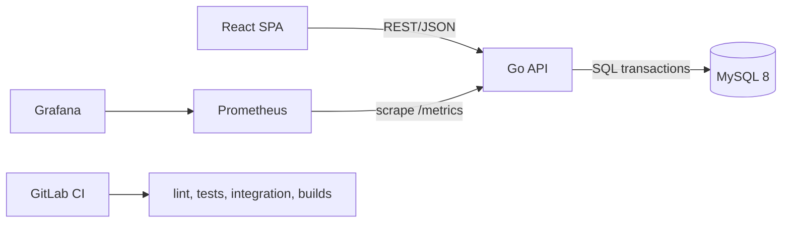
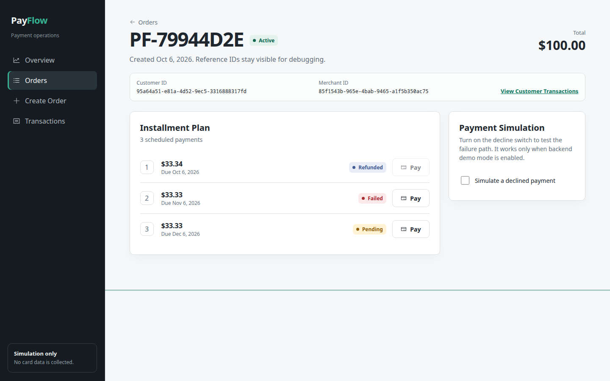

# PayFlow

PayFlow is an educational installment-payments platform built around the parts of payment software that are easy to get wrong: exact money arithmetic, state transitions, transaction boundaries, idempotency, refunds, and an auditable event history.

The project uses simulated payments. It does not collect card data or connect to a payment processor.

## Why I Built This

Installment products look simple from the outside, but a retry, partial failure, or rounding error can create a real accounting problem. PayFlow explores those failure modes in a codebase small enough to understand end to end.

## Architecture



The backend separates HTTP concerns, application rules, and SQL persistence. Payment and refund mutations lock the affected rows and commit state changes with their transaction events. See [architecture notes](docs/architecture.md) and [database notes](docs/database.md).

## Stack

- Backend: Go, Chi, `database/sql`, MySQL 8
- Frontend: React, TypeScript, Vite, TanStack Query, React Hook Form, Zod
- Testing: Go test, a real-MySQL integration suite, Vitest, Testing Library, Playwright
- Infrastructure: Docker Compose, GitLab CI/CD, Kubernetes manifests
- Observability: Prometheus metrics, structured JSON logs, provisioned Grafana dashboard

## Features

- Customers, merchants, orders, and 2-4 installment payment plans
- Integer minor-unit money representation for USD and CLP
- Deterministic remainder distribution, so installments always sum to the order total
- Atomic payment transitions with explicit success and demo-failure paths
- Persistent `Idempotency-Key` handling for payment creation
- Partial and full refunds with over-refund protection
- Paginated customer transaction history
- Request IDs, structured logs, health checks, safe error responses, and security headers
- Responsive SPA with loading, empty, error, and retry states

## Quick Start

Requirements: Docker with the Compose plugin and Make.

```bash
cp .env.example .env
docker compose up --build
```

Open:

- Application: `http://localhost:3000`
- API health: `http://localhost:8080/health`
- Prometheus: `http://localhost:9090`
- Grafana: `http://localhost:3001` (local default: `admin` / `payflow-local`)

Optional synthetic data:

```bash
make seed
```

## API Example

Create a payment with a stable key for that client operation:

```bash
curl -i http://localhost:8080/api/v1/payments \
  -H 'Content-Type: application/json' \
  -H 'Idempotency-Key: checkout-8f2a7f' \
  -d '{"installment_id":"<installment-id>","amount":3000,"simulate_failure":false}'
```

Repeating the same request returns the original payment and the response header `Idempotency-Replayed: true`. Reusing the key for different request data returns `409 IDEMPOTENCY_CONFLICT`.

The complete contract is in [OpenAPI](docs/openapi.yaml).

## Testing

```bash
make test
make lint
make build
```

The integration suite needs an empty MySQL database:

```bash
export TEST_DATABASE_DSN='payflow:password@tcp(localhost:3306)/payflow_test?parseTime=true&multiStatements=true'
make integration-test
```

For the browser flow, start the complete stack and run `cd frontend && npm run e2e`. The test creates an order, pays the first installment, and issues a refund. More detail is in [testing strategy](docs/testing.md).

## CI/CD

`.gitlab-ci.yml` runs formatting and static checks, backend and frontend tests, a MySQL-backed integration job, and production builds. The repository can live on GitHub and be mirrored to GitLab to run the pipeline. It does not include an automatic production deployment.

## Observability

The API exports request rate and latency plus payment, refund, database-error, and idempotency-replay counters at `/metrics`. Prometheus scrapes the API every 10 seconds. Grafana provisions `PayFlow Operations` from version-controlled JSON.

Application logs are structured JSON and include request ID, method, route, status, and duration. Loki is intentionally left out to keep the local stack focused; it is a suitable next step if centralized log search is needed.

## Database Model

Orders belong to a customer and merchant. Each order has one payment plan; each plan owns 2-4 installments. Payments and refunds are append-oriented records, while transaction events provide the customer-facing history. Details and the ER diagram are in [database documentation](docs/database.md).

## Kubernetes

The manifests in `infra/k8s` demonstrate Deployments, Services, probes, a MySQL StatefulSet, resource requests, an Ingress, ConfigMaps, and Secret references. Before applying them, build and publish the two images, replace the example registry paths, create `payflow-secrets`, and generate the migration ConfigMap:

```bash
cp infra/k8s/secret.example.yaml infra/k8s/secret.yaml
# Edit secret.yaml with local cluster values.
kubectl create configmap payflow-migrations --from-file=backend/migrations/
kubectl apply -f infra/k8s/configmap.yaml
kubectl apply -f infra/k8s/secret.yaml
kubectl apply -f infra/k8s/mysql-statefulset.yaml
kubectl apply -f infra/k8s/backend-deployment.yaml -f infra/k8s/backend-service.yaml
kubectl apply -f infra/k8s/frontend-deployment.yaml -f infra/k8s/frontend-service.yaml
```

`secret.example.yaml` is only a template. Do not use its values outside a disposable local cluster.

## Security Considerations

PayFlow validates public input, limits request bodies, parameterizes SQL, sets security headers, restricts CORS, and keeps credentials in environment variables or Kubernetes Secrets. It deliberately has no authentication and must not be exposed to untrusted networks. It is not PCI DSS compliant and stores no payment-card information. See [SECURITY.md](SECURITY.md).

## Engineering Decisions

The main tradeoffs, including transaction isolation, minor units, REST, and the deliberately small dependency set, are recorded in [engineering decisions](docs/decisions.md).

## Screenshots

### Dashboard


### Installment plan



### Observability


## Known Limitations

- No authentication or tenant isolation
- No real payment processor, asynchronous settlement, disputes, taxes, fees, or foreign exchange
- Idempotency records carry a 24-hour expiry timestamp, but no cleanup or expiry-enforcement job is included
- The frontend setup flow can leave a synthetic customer or merchant behind if a later setup request fails
- The API lists at most 100 recent orders and only transaction history is paginated
- Failed installments can be retried, but retry policy and fraud controls are outside scope
- Kubernetes uses a single MySQL pod and example local-cluster settings

## Roadmap

The most valuable next work is authentication and merchant scoping, webhook-style asynchronous payment outcomes, scheduled idempotency cleanup, richer integration failure injection, and OpenTelemetry traces.

## License

[MIT](LICENSE)
