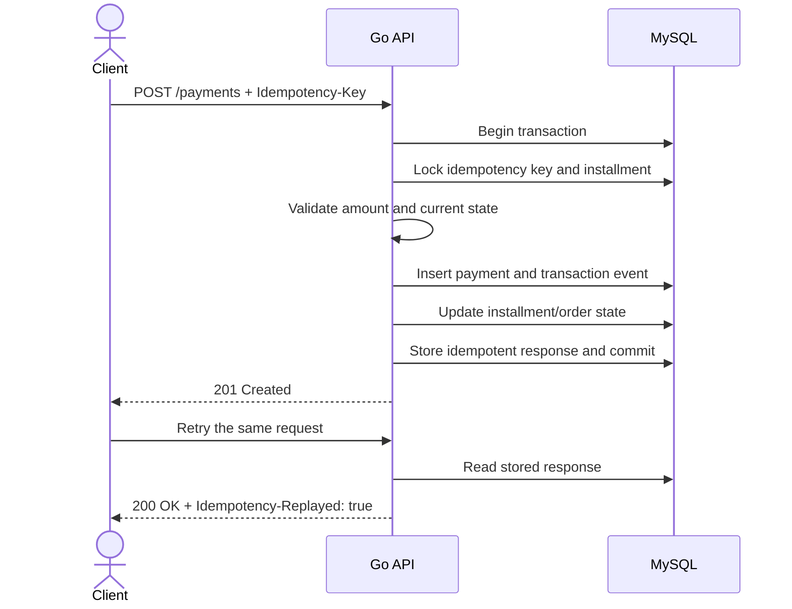
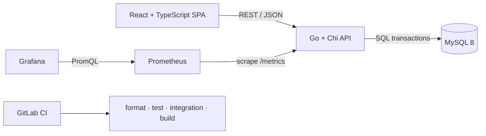

<div align="center">

# PayFlow

**An installment payments sandbox built around the failure paths that matter:**<br>
rounding, retries, duplicate requests, partial refunds, and transaction boundaries.

[**English**](./README.md) · [Español](./README.es.md)


[](./LICENSE)

</div>


PayFlow is a portfolio project I built to explore a simple question: what turns a payment endpoint into a reliable financial operation?

The answer is mostly in the edge cases. A retry must not charge twice. Three installments must still add up to the original total. A partial refund cannot exceed the captured payment. If any write fails halfway through, the database must return to its previous state. This repository keeps those concerns visible instead of hiding them behind a payment provider SDK.

> [!IMPORTANT]
> PayFlow uses simulated payments and stores no card data. It is an engineering case study, not a production payment processor.

<details>
<summary><strong>Contents</strong></summary>

- [What you can do](#what-you-can-do)
- [Run it locally](#run-it-locally)
- [The payment path](#the-payment-path)
- [Architecture](#architecture)
- [API surface](#api-surface)
- [Testing](#testing)
- [Observability](#observability)
- [Repository map](#repository-map)
- [Engineering notes](#engineering-notes)
- [Current limits](#current-limits)

</details>

## What you can do

- Create customers, merchants, orders, and plans with 2–4 installments.
- Pay an installment or deliberately run the declined-payment path.
- Retry a request with the same idempotency key without creating a second payment.
- Issue partial and full refunds while preventing over-refunds.
- Inspect a customer's transaction history and the state of every installment.
- Watch request, latency, payment, refund, replay, and database-error metrics in Grafana.

The interface is intentionally operational rather than checkout-oriented: IDs, states, amounts, and failure controls stay visible because they are useful when tracing a financial workflow.

## Run it locally

You need Docker with the Compose plugin and Make.

```bash
git clone https://github.com/DevPooks/payflow.git
cd payflow
cp .env.example .env
docker compose up --build
```

Once the health checks settle, open:

| Service    | URL                            | Notes                                     |
| ---------- | ------------------------------ | ----------------------------------------- |
| PayFlow    | <http://localhost:3000>        | Create an order and run its first payment |
| API health | <http://localhost:8080/health> | Includes database status                  |
| Prometheus | <http://localhost:9090>        | Raw targets and queries                   |
| Grafana    | <http://localhost:3001>        | `admin` / `payflow-local` for local use   |

Optional synthetic records:

```bash
make seed
```

Stop the stack with `docker compose down`. Add `-v` only when you also want to remove the local MySQL volume.

## The payment path

The interesting part of PayFlow is not the `POST` request by itself; it is what must happen as one unit.



If validation or persistence fails, the transaction rolls back. A reused key with different request data returns `409 IDEMPOTENCY_CONFLICT` instead of guessing what the client intended.

<details>
<summary><strong>Financial invariants enforced by the service</strong></summary>

- Money is represented as integer minor units: `3000` means `$30.00` for USD.
- Installment remainders are distributed deterministically, so every plan sums exactly to its order.
- An installment cannot be paid twice, even with a new idempotency key.
- Refund totals cannot exceed the succeeded payment amount.
- Fully refunding one installment does not mark an order refunded while other installments remain pending.
- Demo failures create an auditable failed payment without moving the installment to a paid state.

</details>

## Architecture



The backend separates HTTP concerns, application rules, and SQL persistence without introducing a framework-heavy abstraction layer. Payment and refund mutations own their transaction boundary in the repository, where row locks and writes can be reviewed together.

The frontend is a single-page application served by Nginx. TanStack Query handles server state; React Hook Form and Zod keep form behavior and validation explicit.

Read the longer rationale in [Architecture](./docs/architecture.md), [Database design](./docs/database.md), and [Engineering decisions](./docs/decisions.md).

## API surface

The complete contract lives in [OpenAPI](./docs/openapi.yaml). The main routes are:

| Area       | Endpoints                                                                                  |
| ---------- | ------------------------------------------------------------------------------------------ |
| Customers  | `POST /api/v1/customers`, `GET /api/v1/customers/{id}`                                     |
| Merchants  | `POST /api/v1/merchants`, `GET /api/v1/merchants/{id}`                                     |
| Orders     | `POST /api/v1/orders`, `GET /api/v1/orders`, `GET /api/v1/orders/{id}`                     |
| Plans      | `POST /api/v1/payment-plans`, `GET /api/v1/payment-plans/{id}`                             |
| Payments   | `POST /api/v1/payments`, `POST /api/v1/installments/{id}/pay`, `GET /api/v1/payments/{id}` |
| Refunds    | `POST /api/v1/payments/{id}/refunds`                                                       |
| History    | `GET /api/v1/customers/{id}/transactions?page=1&page_size=20`                              |
| Operations | `GET /health`, `GET /metrics`                                                              |

Example payment request:

```bash
curl -i http://localhost:8080/api/v1/payments \
  -H 'Content-Type: application/json' \
  -H 'Idempotency-Key: checkout-8f2a7f' \
  -d '{
    "installment_id": "<installment-id>",
    "amount": 3000,
    "simulate_failure": false
  }'
```

## Testing

Tests are concentrated around the places where a money workflow can silently go wrong.

| Layer             | What it checks                                                                                                      |
| ----------------- | ------------------------------------------------------------------------------------------------------------------- |
| Go unit tests     | Remainder distribution, clamped due dates, invalid currency/amount/input, unsupported plan sizes                    |
| MySQL integration | Rollback, idempotent replay, duplicate payment rejection, declined payment, partial/full/over-refund, event history |
| React tests       | Loading announcements, recovery UI, order rendering, localized money, form schema                                   |
| Playwright        | Full create → pay → refund journey in desktop Chromium and a mobile viewport                                        |
| Accessibility     | axe-core audit of the final interface with no reported violations                                                   |

Run the regular checks:

```bash
make lint
make test
make build
```

The MySQL integration suite expects an empty test database:

```bash
export TEST_DATABASE_DSN='payflow:password@tcp(localhost:3306)/payflow_test?parseTime=true&multiStatements=true'
make integration-test
```

With the stack running:

```bash
cd frontend
PLAYWRIGHT_BASE_URL=http://localhost:3000 npm run e2e
```

See [Testing strategy](./docs/testing.md) and the documented [regression example](./docs/regression-example.md).

## Observability

The API writes structured JSON logs with request IDs and exposes Prometheus metrics for HTTP rate/latency, payment outcomes, refunds, idempotency replays, and database errors. Grafana is provisioned from version-controlled files; no dashboard setup is required after startup.


## Repository map

```text
payflow/
├── backend/
│   ├── cmd/api/                 # process entry point
│   ├── internal/
│   │   ├── domain/              # entities and domain errors
│   │   ├── service/             # validation and application rules
│   │   ├── repository/mysql/    # transactions and SQL persistence
│   │   └── transport/httpapi/   # routes and JSON contracts
│   ├── migrations/
│   └── tests/integration/
├── frontend/
│   ├── src/                     # React application
│   └── e2e/                     # Playwright flow
├── infra/
│   ├── grafana/
│   ├── prometheus/
│   └── k8s/
├── docs/
├── scripts/
├── docker-compose.yml
└── .gitlab-ci.yml
```

## Engineering notes

If you are reviewing this as a portfolio project, these are the useful starting points:

- [`service.go`](./backend/internal/service/service.go): public application rules and mutation orchestration.
- [`store.go`](./backend/internal/repository/mysql/store.go): SQL transactions, row locking, and state changes.
- [`payment_flow_test.go`](./backend/tests/integration/payment_flow_test.go): the critical financial behavior in one executable scenario.
- [`000001_initial.up.sql`](./backend/migrations/000001_initial.up.sql): constraints, indexes, and relational model.
- [`OrderDetailPage.tsx`](./frontend/src/pages/OrderDetailPage.tsx): payment and refund interactions in the SPA.
- [`payflow.json`](./infra/grafana/dashboards/payflow.json): the version-controlled operations dashboard.

For interview preparation, [these notes](./docs/interview-notes.md) explain the tradeoffs and the bugs worth discussing.

## Current limits

PayFlow deliberately stops before pretending to be a real processor:

- There is no authentication, authorization, or tenant isolation.
- Payment outcomes are synchronous simulations; there are no provider webhooks or settlement jobs.
- There is no card collection, PCI scope, dispute flow, tax, fee, or foreign-exchange model.
- Idempotency records store an expiry timestamp, but no cleanup worker runs yet.
- The Kubernetes setup demonstrates deployments, services, probes, secrets, ingress, and a MySQL StatefulSet; it is not a highly available database design.
- GitLab CI is configured for validation and builds, not automatic production deployment.

The next meaningful step would be asynchronous payment outcomes through an outbox plus authenticated merchant boundaries—not more surface-level endpoints.

## License

[MIT](./LICENSE) © [DevPooks](https://github.com/DevPooks)
