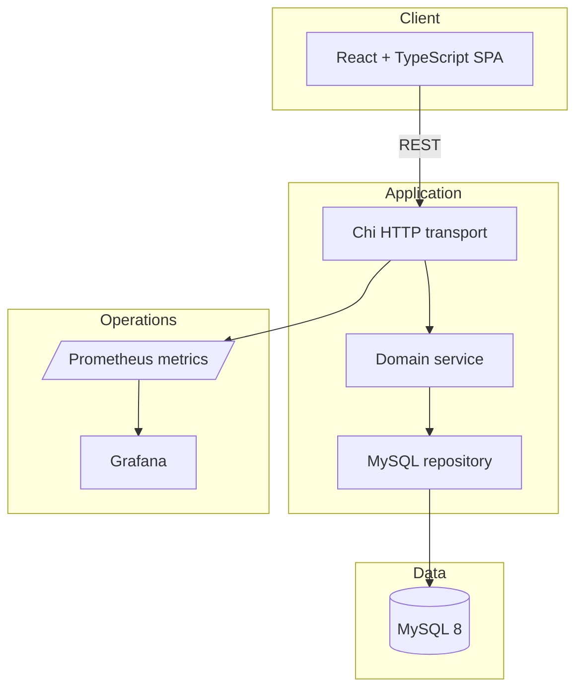
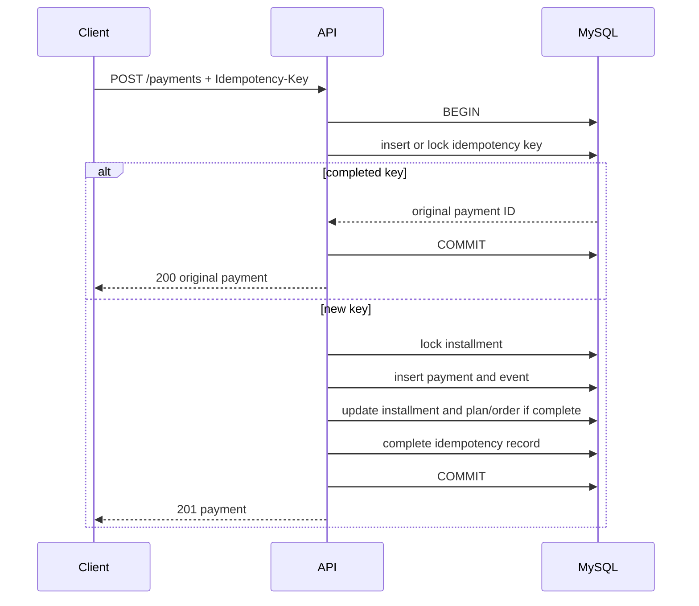

# Architecture

## System Overview

The HTTP layer parses input and maps domain errors to stable API responses. The service owns validation, installment construction, and command creation. The repository owns SQL, row locks, and transaction boundaries. This split keeps business rules testable without hiding SQL behind unnecessary generic abstractions.

## Payment Sequence

The idempotency row and payment mutation share a transaction. `SELECT ... FOR UPDATE` serializes competing operations for the same installment. Any error rolls back the full mutation.

## Frontend

React Router maps the dashboard, order list, order creation, order details, and transaction lookup. TanStack Query owns server state and cache invalidation. React Hook Form with Zod owns input parsing and inline errors. Search state for transaction history lives in the URL.

## CI/CD

GitLab CI has lint, test, integration, and build stages. The integration job starts MySQL 8.4 and runs the same migration and payment flow used locally. Build artifacts are produced, but deployment is intentionally manual.

## Deployment

Docker Compose is the primary local environment. Kubernetes manifests demonstrate the mechanics of a cluster deployment. They are intentionally plain YAML to keep the operational model visible.

