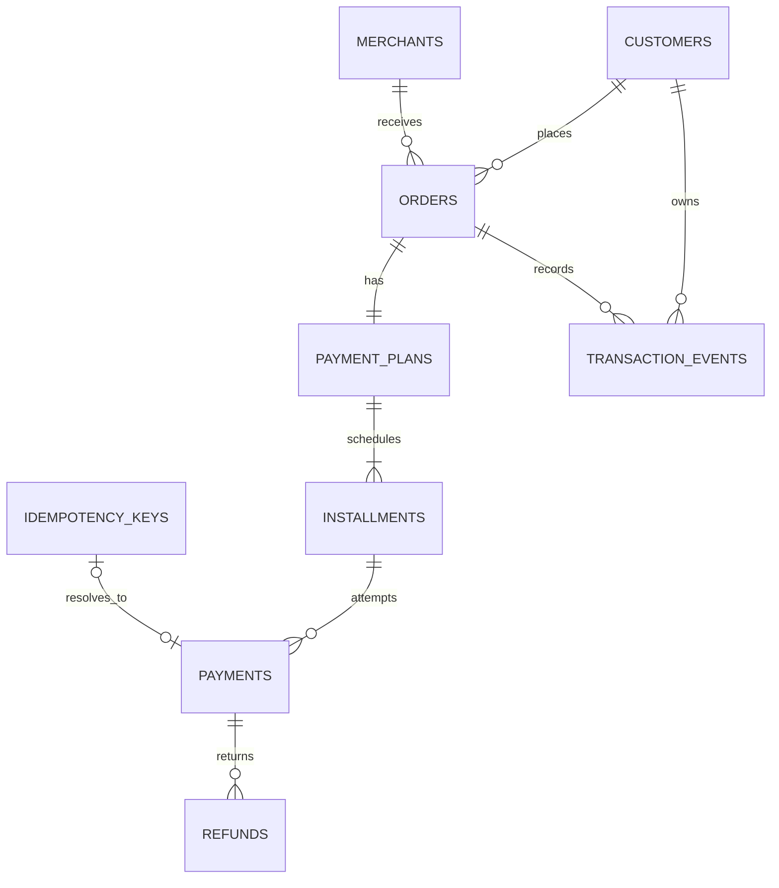

# Database Design

## Money

Money is stored as signed `BIGINT` minor units. USD uses cents, so `3000` means `$30.00`. CLP is represented in its normal zero-decimal form, so `3000` means `CLP 3,000`. The project does not perform currency conversion.

## Constraints and Indexes

- Customer email and order reference are unique.
- Each order can have one payment plan.
- A plan can contain only 2, 3, or 4 installments.
- Installment sequence is unique within its plan.
- Positive amount checks protect orders, installments, payments, and refunds.
- Refund totals are additionally enforced in the transaction before update.
- Customer events and payment attempts have composite indexes matching their main read paths.

## Transactions

Payment creation locks both the idempotency key and installment. It inserts the payment, updates installment state, records the event, and completes the idempotency record before commit. Refunds lock the payment, validate remaining refundable value, write the refund and event, then update payment, installment, plan, and order state.

MySQL uses `READ COMMITTED` for these application transactions. Explicit row locks provide the serialization needed by the affected aggregate without making unrelated reads more restrictive.

## Idempotency Storage

`idempotency_keys` stores the client key, a SHA-256 hash of the payment command, processing state, resolved payment ID, response status, and expiry. The same key with the same hash returns the original payment. The same key with a different hash returns a conflict. A production system would add a cleanup worker and stronger handling for long-running `processing` rows.

